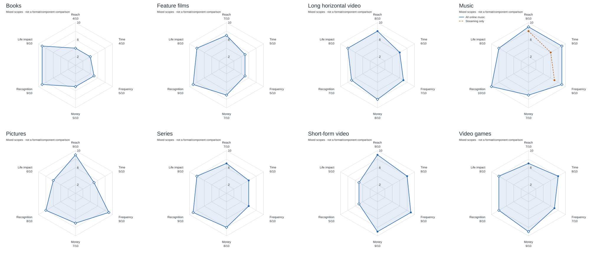
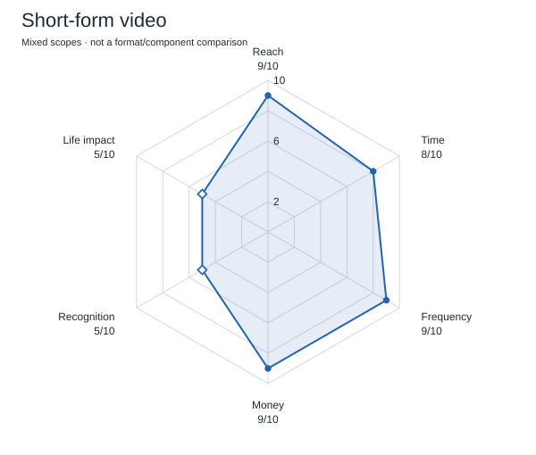
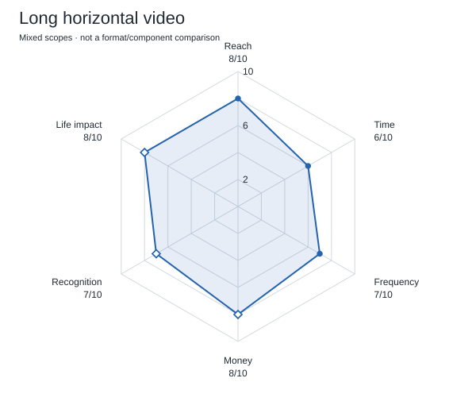
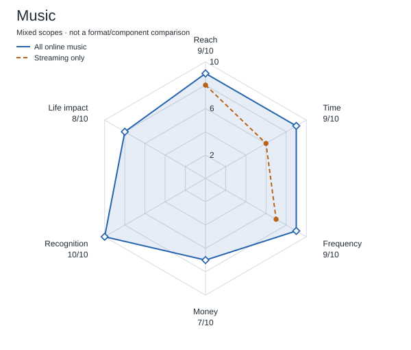
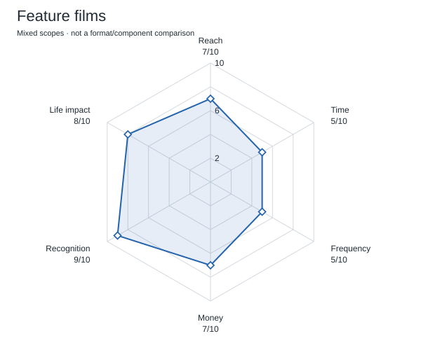
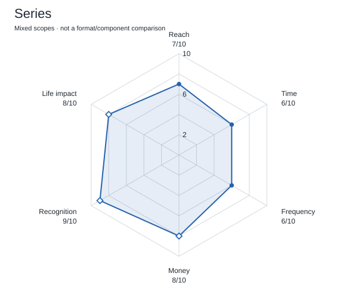
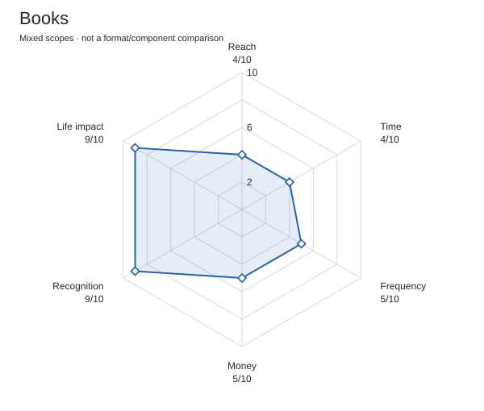
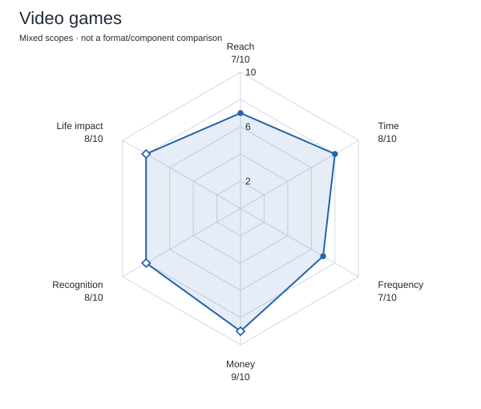
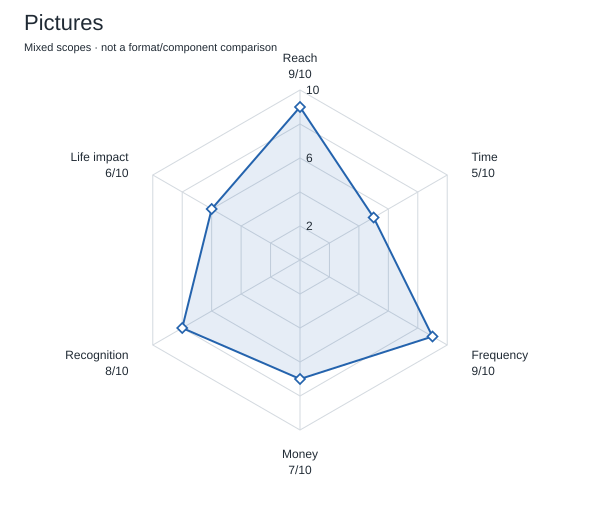

# Subjective 2026 radar profiles

**Scope warning:** these earlier author profiles mix embedded music exposure with mostly standalone work formats. They are retained as author scenarios, not a harmonized comparison of either primary formats or media components. The [two-level framework](../research/01_scope_and_metrics.md#units-of-comparison) supersedes that comparative use. No replacement scores or cross-format component totals have been inferred.

The comparison targets media content distributed through the internet. Offline listening, cinema attendance and print-inclusive sales do not numerically anchor these online-content judgments. Score provenance is recorded in the [audit](subjective_scores_2026.md#revision-rule-and-audit). Unmeasured online-only values remain qualitative judgments.

All eight diagrams use six scored axes on the same 0–10 scale, forming closed, lightly filled profiles. Life impact is subjective author interpretation of potential lasting influence on an engaged person. Research supporting these exact scores or their comparative ordering has not been found in the project review. No calibrated procedure translates evidence into these judgments. Every retained numeric score is an author judgment. Filled points have a numerical source anchor; hollow points have qualitative reasoning only. Neither kind is an objective score. Definitions and all 48 rationale entries are in [the data](score_rationales.md).

The interpretive questions underlying these profiles are centralized in [Project hypotheses](../research/06_hypotheses.md), with answers and confidence in [Findings](../results/01_findings.md#answers-to-the-project-hypotheses). Profile descriptions below explain the model, not independent tests of those questions.

## All eight profiles together

[Open the full-size image](radar-overview.svg) · [Short Russian annotation (TXT)](radar-overview.txt).

## Short-form video

The model emphasizes frequent, broad consumption. Life impact is a subjective 5/10, reflecting possible cumulative habit and perspective changes.

## Long-form horizontal online video

The model covers long online video, including essays, vlogs, news, tutorials, interviews and recordings, separately from feature films and series. It gives room for developed explanation, reflection, and repeated creator contact. Reach, time, and frequency are anchored to the broader GWI long-online-video proxy. Money is a qualitative hypothesis; life impact is a subjective 8/10 and no long-video causal ranking is established. See the [working definition](../research/01_scope_and_metrics.md) and [category-specific limitations](../research/04_limitations.md#long-horizontal-video-limitations).

## Music

The main profile includes direct online listening and audible music in short vertical videos, long horizontal videos, online films, series and games. Its reach/time/frequency are a qualitative 9/9/9. A dashed streaming-only reference shows 8/6/7, informed by 77.4% reach, 301 weekly minutes and 3.10 days/week. These are two definitions, not a measured uplift or confidence interval. Combined exposure is a union, and its size is not identified. All six main-profile markers are hollow; the separate streaming-only reference uses filled points. The presence of embedded music is substantive; its exact audience and contribution to effects remain unmeasured. See [the scenarios](music_online_scenarios.md).

## Feature films

The model separates episodic consumption from a work's potential for remembered characters, scenes, and perspectives.

## Series

The model emphasizes long contact with characters. Its streaming-consumption proxy also includes other content; total Netflix revenue is not a numeric money anchor.

## Books

The model concerns digitally distributed reading only; its first four scores are 4/4/5/5 without numerical anchors from print-inclusive sales or all-format reading diaries. It gives reflection and revisiting ideas high qualitative scores. This does not establish that an average book has greater causal impact than an average game, series, or feed.

## Video games

The model combines broad consumption with agency and shared experience. Applying qualities of narrative-focused games to the full casual-game market is a limitation.

## Pictures

This profile covers online photography, illustration, drawings, collages, and image memes. It hypothesizes broad, recurrent exposure; life impact is a subjective 6/10. All six scored markers are hollow; no comparable numerical consumption/revenue anchor was selected. Memory, news attention, and curated-gallery findings do not calibrate these scores or establish major life effects. See the [pictures appraisals](../research/02_literature_review.md#pictures-research-2024-2026).

## Interpretation

Differences of one point are not meaningful. Allowing roughly two points of judgment on uncertain axes could alter several apparent rankings. Do not add the axes into a single winner. The retained scores describe consumption, market scale, and cultural recognition. The general life-impact scores are author assumptions, with no supporting comparative research found in the project review. These diagrams illustrate author assumptions, not research findings about comparative life influence.
