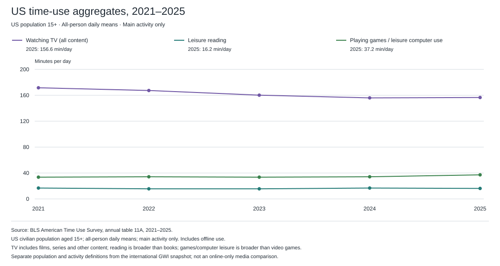
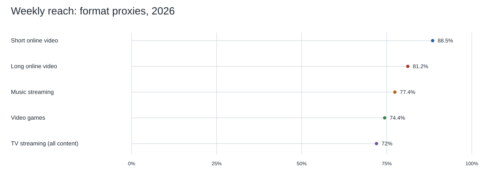
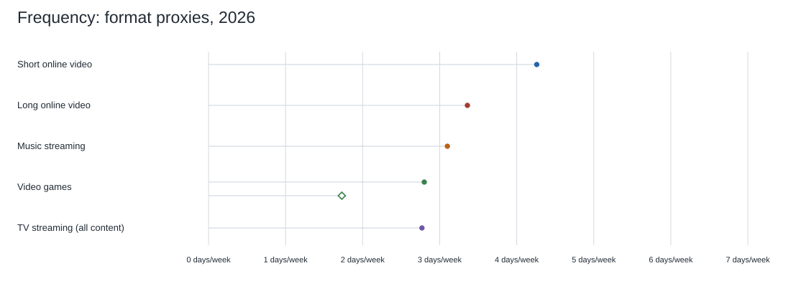
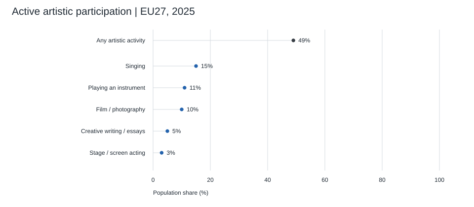
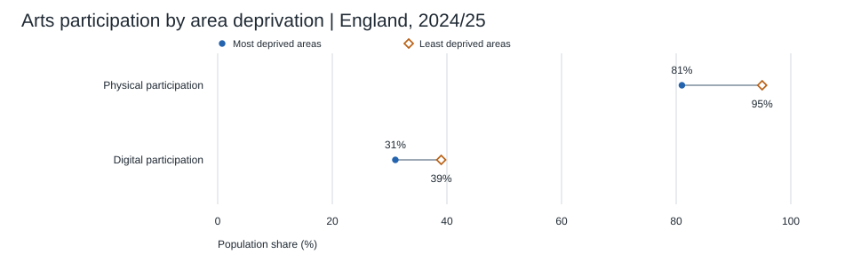

# Findings

Literature-based answers come from an exploratory review with a documented bounded targeted update, not exhaustive literature coverage. Confidence describes the specific conclusion, using [the methods definition](../research/05_methods_and_reproducibility.md#confidence-in-conclusions-and-search-coverage); completeness of the search is separate. Unresolved means not established within the selected evidence, not no effect or no relevant studies anywhere. See [the search and appraisal record](../sources/moderate_review_search_2026.md).

Life influence includes major events and everyday/cumulative changes; [the separate outcome results](06_event_and_cumulative_outcomes.md) cover the latter without requiring a biographical turning point.

## Answers to the project hypotheses

The numbered questions are collected in [Project hypotheses](../research/06_hypotheses.md). H01–H27 retain their question numbers and are grouped below by answer status. The hypotheses file contains questions only.

**Answer status comes before confidence.** A substantive answer states what the research supports about the phenomenon. A partial answer covers only a narrower population, proxy, or part of the question. A tentative answer gives a direction based on indirect or unresolved evidence. **No answer from the available evidence** means the research does not establish a direction for the actual question; no confidence level is assigned to those entries.

For substantive, partial, and tentative answers, confidence is qualitative: **high** requires direct evidence supporting the stated conclusion; **moderate** indicates material limits on scope, identification, or generalization; **low** indicates indirect evidence or unresolved comparability. High confidence that data are missing, that two metrics differ, or that an inference is invalid does not count as a high-confidence answer to a hypothesis. Confidence is not a calculated probability. An unanswered hypothesis is not a rejected hypothesis, and radar scores are not independent supporting evidence.

### Substantive answers

| ID | Answer from the research | Confidence and reason | Evidence in the project |
| --- | --- | --- | --- |
| H18 | There is evidence consistent with a consequential effect in a specific setting: the Brazilian soap-opera study links coverage expansion and depictions of smaller families to fertility outcomes. The whole proposed chain is not separately identified. | Moderate for that bounded case: it is quasi-experimental and depends on identification assumptions. Low for generalization to all series, characters, norms, or viewing patterns. | [Soap-opera study appraisal](../research/02_literature_review.md#consequential-outcomes-associated-with-television-stories) |
| H22 | Yes in studied settings: experimental synthesis supports effects on beliefs and message-consistent behavior, and delayed-outcome research supports persistence in some cases. This does not establish lifelong transformation or an eight-medium ranking. | Moderate overall: evidence is directly relevant, but settings and outcomes are bounded, and the persistence meta-analysis was appraised from its indexed abstract only. | [Narrative and persistence appraisals](../research/02_literature_review.md) |
| H23 | No in the selected England observations: physical arts engagement is 81% versus 95% across the most/least deprived area groups, digital engagement 31% versus 39%, and selected regional physical-engagement values also differ. | High for the reported bounded survey contrasts, with nonresponse and classification limits. Insufficient evidence for each medium globally; area deprivation is not individual income. | [Participation data and survey notes](../data/participation_and_breadth.md) |

### Partial answers

| ID | Answer from the research | Confidence and reason | Evidence in the project |
| --- | --- | --- | --- |
| H01 | Short video leads the available labeled proxies in the online-adult snapshot at 88.5% weekly reach. Leadership across all eight media or the world population is unresolved. | Moderate for a partial answer: direct survey evidence supports leadership among measured proxies, but streaming-only music and missing film, book, and picture observations prevent answering the full comparison. | [2026 snapshot](../data/media_use_2026.md) |
| H02 | Short video does not lead the reported weekly-time figures: games have 433 minutes against 426 for short video. A complete eight-medium ranking is unavailable. | Low for a partial negative answer: games have the higher reported point estimate, but the small gap was not tested for significance and the full comparison is incomplete. | [2026 snapshot](../data/media_use_2026.md) |
| H03 | Short video leads the available labeled frequency proxies at 4.26 days per week. The full eight-medium comparison is unresolved. | Moderate for a partial answer: direct survey evidence supports leadership among the reported frequency proxies, but categories are missing and game frequency is device-specific. | [2026 snapshot](../data/media_use_2026.md) |
| H06 | Yes for the broader short/long online-video survey proxies: short video has higher reach, weekly time, and days per week. The exact vertical-versus-horizontal creative-work comparison is unresolved. | Moderate for a partial positive answer: all three survey measures favor short online video, but the proxies do not isolate vertical versus horizontal creative works. | [2026 snapshot](../data/media_use_2026.md), [category definition](../research/01_scope_and_metrics.md#long-form-horizontal-online-video) |
| H25 | Relevant but bounded evidence: curated online art viewing supports experiential outcomes, memes can attract news attention, and image memorability correlates with commenting. | Moderate for a partial answer within the studied settings; insufficient evidence for enduring cultural recognition, major life decisions, or a cross-medium ranking. | [Pictures appraisals](../research/02_literature_review.md#pictures-research-2024-2026) |
| H26 | Creation and sharing should be measured separately from viewing. Photo sharing can affect recall; creator main-type shares do not measure all-population participation or belonging. | Moderate for a partial answer on the specific memory procedure; insufficient evidence for universal accessibility, belonging, or global participation ranks. | [Participation notes](../data/participation_and_breadth.md#pictures-and-digital-creation-australia-report-2026), [pictures review](../research/02_literature_review.md#pictures-research-2024-2026) |
| H27 | Evidence leans against the blanket claim: the same US survey shows less even income-group adoption of TikTok than some platform comparators. This is a partial negative answer, not a global short-video ranking against books, music, films, or other creative media. | Moderate for the bounded platform countercomparison; low for the full hypothesis. Adoption is not viewing time, platforms mix formats, demographic gaps are unadjusted, and differences between gaps were not tested for significance. | [Social-breadth assessment and original sources](../research/07_short_video_social_breadth.md) |

### Tentative answers

| ID | Answer from the research | Confidence and reason | Evidence in the project |
| --- | --- | --- | --- |
| H04 | Tentative support from the GMI26 publisher analysis: its authors report short video as the fastest-growing measured format. Worldwide leadership across the project's eight creative-media categories remains unestablished. | Low for the comparative hypothesis: common waves, populations, uncertainty and the growth metric were not independently audited; GMI26 and DataReportal share GWI data. Moderate confidence applies only to growth of services in several measured settings, corroborated by Ipsos iris and Qustodio. | [Updated growth assessment](05_growth_feasibility.md#additional-evidence-and-updated-confidence), [source appraisal](../research/08_growth_evidence_search.md) |
| H05 | Tentative support comes from GMI26's reported leadership among its measured formats. The dossier has not independently established faster short-video growth than long online video and TV. The +5.97% and +0.67% published-value differences establish neither consumption direction nor relative growth. | Low for this comparison: GMI26's paired series and absolute-versus-percentage ranking remain unaudited. Independent TikTok measurements strengthen bounded service-growth evidence but do not test this format comparison. | [Updated growth assessment](05_growth_feasibility.md#additional-evidence-and-updated-confidence) |
| H12 | Plausible, with added repeated-exposure and timescale evidence; cumulative causal effects specific to creative short-video feeds remain unresolved. | Low for the actual hypothesis: the new studies distinguish trajectories from repeated responses, include null carryover, and often measure images or mixed platforms rather than the target feed. | [Cumulative-effects appraisal](../research/08_cumulative_media_effects.md), [separate outcomes](06_event_and_cumulative_outcomes.md) |

### No answer from the available evidence

| ID | Answer from the research | Confidence and reason | Evidence in the project |
| --- | --- | --- | --- |
| H07 | Not established. The financial landmarks cannot identify the largest medium under a common market boundary. | Not assigned: reels is an annualized pace for one company; other values mix global markets, company revenue, US publishing. | [Financial observations](../data/annual_indicators.md), [source comparison](../research/03_source_comparison.md) |
| H08 | Unresolved. The idea that individual clips are recognized for less time is an interpretive assumption in the radar rationale. | Not assigned: no matched longitudinal recognition test of specified works was selected. Recognition of memes, franchises, creators, and individual works must be distinguished. | [Recognition rationales](../data/score_rationales.md), [limitations](../research/04_limitations.md) |
| H09 | Unresolved. No comparable incidence of turning points is established. Detailed impact scores have been removed from the radars; the replacement general life-impact scores are author interpretation, not an answer established by research. | Not assigned: no comparable population rates or causal estimates exist in the selected material. | [Radar profiles](02_radar_profiles.md), [limitations](../research/04_limitations.md#bias-in-the-impact-ratings) |
| H10 | Unresolved. The research does not establish that books cause major life changes more often than short videos. | Not assigned: neither a matched comparison nor a common attributable major-life-change outcome was obtained. Narrative research cannot supply this medium ranking. | [Literature review](../research/02_literature_review.md#what-the-literature-does-not-supply) |
| H11 | Reflection and revisiting a text are proposed mechanisms; greater persistence relative to other media is untested here. | Not assigned: no comparative durable-effect estimate or test isolating rereading and notes was obtained; detailed impact ratings have been removed. | [Book rationales](../data/score_rationales.md), [radar limitations](../research/04_limitations.md#bias-in-the-impact-ratings) |
| H13 | Unresolved for completed major decisions. A selected short-video experiment measures a sign-up click, not enrollment or a major life change. | Not assigned: the click result is indirect evidence that some short messages can elicit an initial behavioral response; it cannot establish the proposed major decision. | [Short-video experiment appraisal](../research/02_literature_review.md#short-video-and-a-measured-behavioral-step) |
| H14 | Unresolved. Longer explanation and repeated creator contact are proposed mechanisms, not demonstrated superiority over short video. | Not assigned: no category-specific causal comparison was selected; duration, genre, instruction, and creator attachment are not separated. | [Long-video literature applicability](../research/02_literature_review.md#applicability-to-the-added-long-video-category), [limitations](../research/04_limitations.md#additional-limitations-introduced-by-long-horizontal-video) |
| H15 | Unresolved. Creator relationships and communities are candidate contributors to influence, but their additional effect is not measured. | Not assigned: the dossier does not separate creator attachment, social environment, repeated exposure, and the individual work. | [Long-video limitations](../research/04_limitations.md#additional-limitations-introduced-by-long-horizontal-video), [proposed study](03_next_study.md) |
| H16 | These remain proposed mechanisms; their causal contribution to durable recognition, identity, and biography is not established here. The radar no longer scores detailed personal effects. | Not assigned: listening surveys describe use and reported importance, not a longitudinal causal test of transmission and identity. | [Music rationales](../data/score_rationales.md), [music source scope](../sources/source_register.md) |
| H17 | Unresolved. Episodic film consumption and persistence through scenes or discussion are model assumptions. | Not assigned: feature-film frequency is not isolated in the snapshot, and no matched study tests the proposed persistence mechanism. General narrative findings are indirect. | [Film rationales](../data/score_rationales.md), [2026 snapshot](../data/media_use_2026.md), [literature review](../research/02_literature_review.md) |
| H19 | Unresolved. Agency, practice, and communities are proposed mechanisms; persistent real-world transfer is not demonstrated by the selected evidence. | Not assigned: the game market and consumption observations do not measure these outcomes, and no direct causal study of the proposed mechanisms was appraised. | [Game rationales](../data/score_rationales.md), [impact-rating limits](../research/04_limitations.md#bias-in-the-impact-ratings) |
| H20 | No answer on the relationship: the dossier does not establish whether media with greater reach, consumption time, or revenue cause more life change. Distinguishing the metrics is a methodological note, not an empirical answer. | Not assigned: no comparable attributable life-change outcome is available to test the relationship. | [Metric definitions](../research/01_scope_and_metrics.md#ten-dimensions), [literature gaps](../research/02_literature_review.md#what-the-literature-does-not-supply) |
| H21 | No answer on whether meaningful or emotionally intense media experiences lead to consequential action. Distinguishing appreciation from action does not establish their relationship. | Not assigned: no selected study estimates the proposed transition to completed consequential action. | [Meaningfulness appraisal](../research/02_literature_review.md#meaningfulness-beyond-enjoyment), [outcome boundaries](../research/03_source_comparison.md) |
| H24 | No clean video-specific ranking can be inferred. EU27 reports film-making/photography at 10%, singing at 15%, instruments at 11%, writing at 5%. | Not assigned: video and photography are combined, and overlapping activities cannot be summed into medium totals. The source-category values do not resolve the question. | [EU27 participation observations](../data/participation_and_breadth.md#eu27-active-artistic-participation) |

## Answer to the initial question

Short-form vertical video is one of the central forms of everyday mass culture by 2026. Additional evidence gives moderate confidence that short-video services grew in several measured audiences; the fastest-growth ranking remains a low-confidence tentative interpretation of the GMI26 publisher analysis. See the [growth assessment](05_growth_feasibility.md#additional-evidence-and-updated-confidence). The available online-adult snapshot supports broad reach and frequent use, but not absolute leadership across every definition of massness. Music also circulates inside other media. A complete global art-only ranking cannot be calculated from the selected evidence.

## What can be compared empirically

Financial observations are retained in the [source table](../data/annual_indicators.md), with their [measurement boundaries](../research/03_source_comparison.md#financial-boundaries). They cover different markets, geographies, and accounting periods, so no common financial chart or cross-category commercial ranking is shown.

This is a consistent national diary series of broad activity categories, not eight global art forms. Minor annual movements were not tested for significance.

The snapshot separates observed categories from missing data. It does not isolate feature films or books, and TV streaming is only a proxy for series. Source: [GWI / DataReportal](https://datareportal.com/reports/digital-2027-global-overview-report).

## What adding long horizontal video changes

Long-form horizontal creator video is one of the eight categories, separate from feature films and series. Its available consumption proxy is GWI long online video: 81.2% weekly reach, 299 minutes per week (42.7 per day), and 3.36 days per week. These values are below the short-video proxy on all three dimensions in this snapshot, but do not isolate horizontal artistic works. The change therefore broadens the comparison without establishing a new art-only ranking. [GWI / DataReportal](https://datareportal.com/reports/digital-2027-global-overview-report).

The financial chart includes an explicitly missing long-video series rather than substituting YouTube totals. The new radar describes hypotheses about developed ideas, creator relationships, and repeated viewing. There is no measured major-life-change rate for this category. New limitations concern the duration/orientation definition, overlap with films and other media, mixed artistic and instructional mechanisms, creator effects, and missing revenue/history. See [limitations](../research/04_limitations.md#additional-limitations-introduced-by-long-horizontal-video).

## Additional evidence on mass participation

Two selected recent official surveys add social and territorial breadth (England, Participation Survey) and active artistic participation (EU27, Eurobarometer 562). Their observations and survey bases are in the [participation tables](../data/participation_and_breadth.md).

The England results show unequal participation across area-deprivation groups. The EU results measure creation and performance separately from audience consumption. These are additional dimensions of mass participation, not a new global ranking. Their survey periods precede 2026, and their categories do not match the eight art categories. Neither source measures common recognition of particular works or causal life impact.

[Annotation and sources](../figures/active-participation-eu-2025.txt).

[Annotation, marker legend, and sources](../figures/social-breadth-england-2024-25.txt).

## What can be said about life impact

Research supports distinguishing a meaningful experience, changed beliefs, intentions, and actual behavior. Some narrative interventions influence behavior; a narrow short-video experiment also measured a behavioral step. These findings do not supply a common probability of major life change for each artistic medium. See the [literature review](../research/02_literature_review.md).

“Books change lives more than reels” remains a plausible personal or author hypothesis, not an established conclusion of this dossier. “Reels cannot change lives” is also unsupported. A feed's cumulative influence and a single work's influence are different research objects.

## Working conclusion

Use **reach and time** to describe mass consumption, **financially scoped revenue** to describe commercial scale, and **durable attributable outcomes** to describe life impact. Keep the axes separate. The strongest result of this research is the distinction between them, not a universal winner.

## What adding pictures changes

Pictures are the eighth category: photography, illustration, drawings, collages, and image memes distributed online. The research now addresses visual memory, image sharing, curated digital viewing, and meme attention alongside longer works. It does not establish that low time per image means low influence.

No compatible pictures-only reach, time, frequency, or revenue observation was selected. Their rows remain gaps in the empirical charts. The new radar is an explicitly subjective hypothesis with ten hollow markers, not a summary of measured effects. At the time of the pictures extension the other seven profiles were unchanged; the subsequent [online-scope revision](../data/subjective_scores_2026.md#revision-rule-and-audit) reassesses consumption and money judgments across all eight categories. See the [working definition](../research/01_scope_and_metrics.md#pictures) and [source appraisals](../research/02_literature_review.md#pictures-research-2024-2026).
