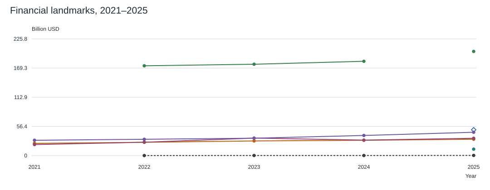

# Findings

## Answer to the initial question

Short-form vertical video is one of the central forms of everyday mass culture by 2026. The available online-adult snapshot supports broad reach and frequent use, but not absolute leadership across every definition of massness. Music also circulates inside other media. A complete global art-only ranking cannot be calculated from the selected evidence.

## What can be compared empirically

The financial figure includes eight labeled categories but deliberately mixes clearly identified landmarks. It is not a scope-harmonized industry ranking. Reels is an annualized pace, Netflix includes films, books cover US fiction, and theater covers Broadway plays. Newzoo has a reporting-vintage break. See [source comparison](../research/03_source_comparison.md).

This is a consistent national diary series of broad activity categories, not eight global art forms. Minor annual movements were not tested for significance.

The snapshot separates observed categories from missing data. It does not isolate feature films, books, or theater, and TV streaming is only a proxy for series. Source: [GWI / DataReportal](https://datareportal.com/reports/digital-2027-global-overview-report).

## What adding long horizontal video changes

Long-form horizontal creator video is now an eighth category, separate from feature films and series. Its available consumption proxy is GWI long online video: 81.2% weekly reach, 299 minutes per week (42.7 per day), and 3.36 days per week. These values are below the short-video proxy on all three dimensions in this snapshot, but do not isolate horizontal artistic works. The change therefore broadens the comparison without establishing a new art-only ranking. [GWI / DataReportal](https://datareportal.com/reports/digital-2027-global-overview-report).

The financial chart includes an explicitly missing long-video series rather than substituting YouTube totals. The new radar describes hypotheses about developed ideas, creator relationships, and repeated viewing. There is no measured major-life-change rate for this category. New limitations concern the duration/orientation definition, overlap with films and other media, mixed artistic and instructional mechanisms, creator effects, and missing revenue/history. See [limitations](../research/04_limitations.md#additional-limitations-introduced-by-long-horizontal-video).

## Additional evidence on mass participation

Two selected recent official surveys add social and territorial breadth (England, Participation Survey) and active artistic participation (EU27, Eurobarometer 562). Their observations and survey bases are in the [participation tables](../data/participation_and_breadth.md).

The England results show unequal participation across area-deprivation groups. The EU results measure creation and performance separately from audience consumption. These are additional dimensions of mass participation, not a new global ranking. Their survey periods precede 2026, and their categories do not match the eight art categories. Neither source measures common recognition of particular works or causal life impact.

[Annotation and sources](../figures/active-participation-eu-2025.txt).

[Annotation, marker legend, and sources](../figures/social-breadth-england-2024-25.txt).

## What can be said about life impact

Research supports distinguishing a meaningful experience, changed beliefs, intentions, and actual behavior. Some narrative interventions influence behavior; a narrow short-video experiment also measured a behavioral step. These findings do not supply a common probability of major life change for each artistic medium. See the [literature review](../research/02_literature_review.md).

“Books change lives more than reels” remains a plausible personal or author hypothesis, not an established conclusion of this dossier. “Reels cannot change lives” is also unsupported. A feed's cumulative influence and a single work's influence are different research objects.

## Working conclusion

Use **reach and time** to describe mass consumption, **financially scoped revenue** to describe commercial scale, and **durable attributable outcomes** to describe life impact. Keep the axes separate. The strongest result of this research is the distinction between them, not a universal winner.
