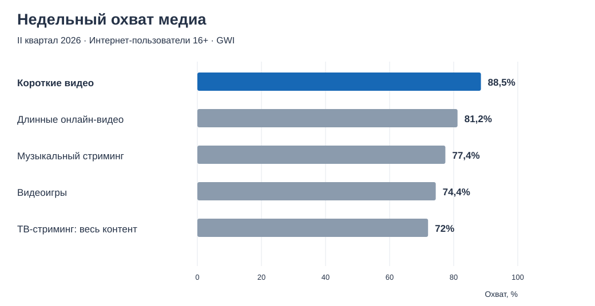
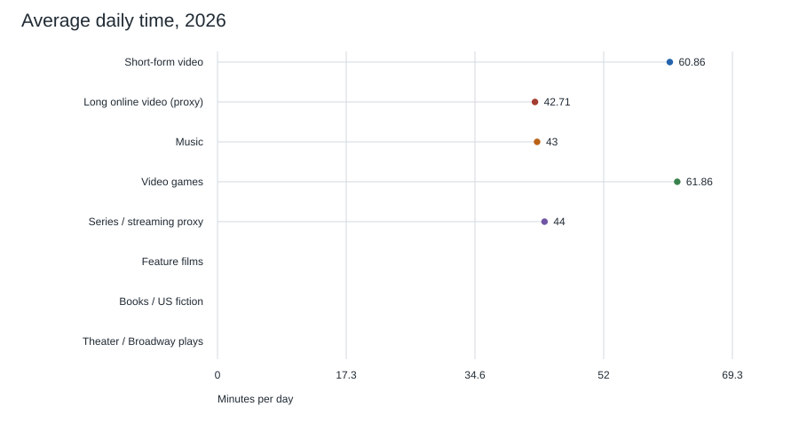
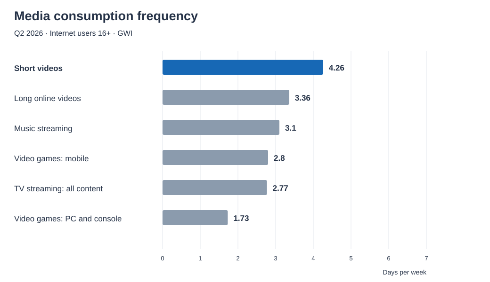

# Findings

Literature-based answers now use a moderate targeted review with [matched outcome searches](../sources/balanced_review_search_2026.md) and a [shared eight-format evidence matrix](../research/09_balanced_literature_review.md). Search coverage remains bounded. Confidence describes a specific conclusion using [the methods definition](../research/05_methods_and_reproducibility.md#confidence-in-conclusions-and-search-coverage); it does not certify completeness. Null findings, access failures and unresolved outcomes remain distinct.

Life influence includes major events and everyday/cumulative changes; [the separate outcome results](06_event_and_cumulative_outcomes.md) cover the latter without requiring a biographical turning point.

## Media formats and components

The [two-level framework](../research/01_scope_and_metrics.md#units-of-comparison) separates primary work formats from components across those works. Current survey comparisons concern broad format proxies only: the music-streaming row is not all musical exposure, and a standalone-picture gap is not evidence that images are absent from video. An creator showing a painting in a vertical video contributes short-video-format exposure and image-component exposure. Music, text and speech receive the same cross-format treatment. The [separate component comparison](../data/media_components_2026.md) has no matched numerical totals, so a component ranking remains unresolved. The old mixed-scope author radars do not answer either comparison.

## Answers to the project hypotheses

The numbered questions are collected in [Project hypotheses](../research/06_hypotheses.md). H01–H30 retain their question numbers and are grouped below by answer status. The hypotheses file contains questions only.

**Status is determined before confidence**, using the same [scope-fit rule](../research/05_methods_and_reproducibility.md#hypothesis-answer-status-and-scope-fit) for every question. All questions inherit the online media-content scope. Check content/distribution, exposure unit, population, comparator, outcome/follow-up and required causal identification. The Scope fit column states the decisive limits; it is not a quality score.

A **substantive answer** addresses the original claim without material narrowing. A **partial answer** supports an explicit narrower subquestion or labeled operational proxy, without answering the whole hypothesis. **No answer from the available evidence** applies when only other-category, offline or untested-mechanism evidence is available, or the requested outcome/contrast is not established. Such evidence can remain useful context. No directional confidence is assigned to an unanswered hypothesis. There is no separate Tentative status: uncertainty in a bounded result is reported under confidence, and untested explanations remain hypotheses.

Confidence is qualitative and applies only to the stated bounded finding, not automatically to the original question. A strong local observation can therefore have a partial status. Search completeness is separate; an unanswered hypothesis is neither rejected nor shown to have no effect. Author radar scores are not research evidence.

### Substantive answers

None of H01–H30 currently meets the full-scope criterion on the selected and appraised evidence. This does not invalidate narrower observations or contextual studies.

### Partial answers

| ID | Answer from the research | Confidence and reason | Scope fit | Evidence in the project |
| --- | --- | --- | --- | --- |
| H01 | Short video leads the available labeled proxies in the online-adult snapshot at 88.5% weekly reach. Leadership across all eight media or the world population is unresolved. | Moderate for a partial answer: direct survey evidence supports leadership among measured proxies, but the narrow music-streaming proxy and missing film, digital-book, and standalone-picture observations prevent answering the full comparison. | Proxy/category and comparison coverage: missing media; online-adult population only. | [2026 snapshot](../data/media_use_2026.md) |
| H02 | The reported point estimates are 433 weekly minutes for games and 426 for short video. This is a bounded proxy observation; neither a statistically established difference nor a complete eight-medium ranking is available. | Low for the bounded point-estimate comparison: the small gap was not tested for significance, distribution methods are not isolated and full comparison coverage is incomplete. | Point-estimate proxy contrast only; online game scope and significance unresolved. | [2026 snapshot](../data/media_use_2026.md) |
| H03 | Short video leads the available labeled frequency proxies at 4.26 days per week. The full eight-medium comparison is unresolved. | Moderate for a partial answer: direct survey evidence supports leadership among the reported frequency proxies, but categories are missing and game frequency is device-specific. | Proxy/category and coverage mismatch; device-specific game frequency. | [2026 snapshot](../data/media_use_2026.md) |
| H04 | Partial: short video has the highest reported percentage growth among 12 GMI26 categories, +5.2% in the H1 2026 chart. | Moderate for this bounded descriptive ranking after inspecting chart 573622; uncertainty and matched-wave composition remain unaudited. The author transcript describes year-on-year growth. | Internet users 16–64; source categories, no separate digital books/pictures or isolated vertical orientation; not all eight target formats. | [Transcribed chart](../data/media_growth_h1_2026.md), [growth assessment](05_growth_feasibility.md#additional-evidence-and-updated-confidence) |
| H05 | Partial: reported short-video growth (+5.2%) exceeds long online video (+1.4%), video streaming (+1.3%) and broadcast TV (−5.9%) in GMI26. | Moderate for the bounded survey-proxy comparison; point-estimate differences have no significance test in the screenshot. Older +5.97% and +0.67% cross-release arithmetic remains unsuitable. | H1 2026, internet users 16–64; vertical/horizontal orientation unverified, streaming mixes films/series/other programmes. | [Transcribed chart](../data/media_growth_h1_2026.md), [growth assessment](05_growth_feasibility.md#additional-evidence-and-updated-confidence) |
| H06 | Yes for the broader short/long online-video survey proxies: short video has higher reach, weekly time, and days per week. The exact vertical-versus-horizontal media-work comparison is unresolved. | Moderate for a partial positive answer: all three survey measures favor short online video, but the proxies do not isolate vertical versus horizontal media works. | Broader online-video proxies; vertical/horizontal orientation unverified. | [2026 snapshot](../data/media_use_2026.md), [category definition](../research/01_scope_and_metrics.md#long-form-horizontal-online-video) |
| H25 | Relevant but bounded evidence: memes can attract news attention, and image memorability correlates with commenting. | Moderate for a partial answer within the studied settings; insufficient evidence for enduring cultural recognition, major life decisions, or a cross-medium ranking. | Attention/commenting proxies only; meaningful experience, enduring recognition and consequential action remain unestablished. | [Attention/circulation context](../sources/literature_leads_archive_2026.md), [influence-outcome matrix](../research/09_balanced_literature_review.md) |
| H26 | Photo sharing can affect recall in a bounded experimental procedure; the available evidence does not establish population creation rates or perceived belonging. | Moderate for that memory result; insufficient evidence for other parts of the question. | Bounded photo-sharing memory procedure; remixing, barriers and belonging not jointly compared. | [Sharing/memory context](../sources/literature_leads_archive_2026.md#sharing-and-memory-picshare25) |
| H27 | Partial proxy comparison: the same US survey reports a larger income-endpoint adoption gap for TikTok than for some platforms and a smaller gap than for another. This does not determine whether short-video consumption is more evenly distributed than the other media. | Moderate for the reported proxy contrasts; no confidence assigned to the full media ranking. Platform adoption is not format-specific consumption, demographic gaps are unadjusted and differences between gaps were not tested for significance. | US platform-adoption proxy, not matched media consumption or global social coverage. | [Social-breadth assessment and original sources](../research/07_short_video_social_breadth.md) |
| H28 | Partial support: in an observational panel of existing video-game players, ordinary changes in objectively measured play time showed little evidence of a meaningful effect on well-being over six weeks. Weak prediction across all media, doses and follow-up periods remains unestablished. | Moderate for this bounded association result; no out-of-sample predictive-model test or universal causal conclusion. | Existing game players over six weeks, not all media/doses/follow-up periods. | [Play-time and well-being appraisal](../research/02_literature_review.md#consumption-hours-and-changes-in-well-being-h28) |

| H18 | Partial evidence for a narrower online-series question: one targeted digital drama episode improved selected appearance-diversity attitudes in girls, while body satisfaction did not differ. Repeated exposure, social-norm pathways and consequential behavior remain unresolved. | Low, provisional abstract-level evidence; no full-text bias or delayed-outcome assessment. No confidence assigned to the full repeated-series claim. | One episode and selected attitudes, not a season, a mechanism test or completed action. | [SHORTDRAMA23 appraisal](../research/09_balanced_literature_review.md#one-digital-series-episode-shortdrama23) |
| H22 | Partial online evidence: an experiment with a full-length film changed empathic accuracy and reform attitudes. The mock-petition contrast was not significant; persistence and completed real-world behavior remain unresolved. | Moderate for the bounded film-content/attitude contrast based on inspected randomized methods/results; no confidence assigned to a general persistent behavior effect. | Online feature-film content contrast and immediate outcomes, not an eight-format comparison or delayed action. | [FILM24 appraisal](../research/09_balanced_literature_review.md#online-feature-film-film24) |

### No answer from the available evidence

| ID | Answer from the research | Confidence and reason | Scope fit | Evidence in the project |
| --- | --- | --- | --- | --- |
| H07 | Not established. The financial landmarks cannot identify the largest medium under a common market boundary. | Not assigned: reels is an annualized pace for one company; other values mix global markets, company revenue, US publishing. | Incompatible market boundaries; no common online commercial measure. | [Financial observations](../data/annual_indicators.md), [source comparison](../research/03_source_comparison.md) |
| H08 | Unresolved. The idea that individual clips are recognized for less time is an interpretive assumption in the radar rationale. | Not assigned: no matched longitudinal recognition test of specified works was selected. Recognition of memes, franchises, creators, and individual works must be distinguished. | No matched specified-work recognition outcome or follow-up. | [Recognition rationales](../author-interpretations/score_rationales.md), [limitations](../research/04_limitations.md) |
| H09 | Unresolved. No comparable incidence of turning points is established. Detailed impact scores have been removed from the radars; the replacement general life-impact scores are author interpretation, not an answer established by research. | Not assigned: no comparable population rates or causal estimates exist in the selected material. | No comparable attributable turning-point rates for individual works. | [Radar profiles](../author-interpretations/02_radar_profiles.md), [limitations](../research/04_limitations.md#bias-in-the-impact-ratings) |
| H10 | Unresolved. The research does not establish that books cause major life changes more often than short videos. | Not assigned: neither a matched comparison nor a common attributable major-life-change outcome was obtained. Narrative research cannot supply this medium ranking. | No matched book/short-video causal contrast on major life changes. | [Literature review](../research/02_literature_review.md#what-the-selected-evidence-does-not-establish) |
| H11 | Reflection and revisiting a text are proposed mechanisms; greater persistence relative to other media is untested here. | Not assigned: no comparative durable-effect estimate or test isolating rereading and notes was obtained; detailed impact ratings have been removed. | No comparative persistence test isolating the proposed mechanisms. | [Book rationales](../author-interpretations/score_rationales.md), [radar limitations](../research/04_limitations.md#bias-in-the-impact-ratings) |
| H12 | Not established for short-video feeds. Image trajectories and mixed-platform diary associations provide context, not evidence that repeated short-video exposure causes persistent changes in beliefs, norms and behavior. | Not assigned to H12: content category, exposure, causal identification and post-exposure persistence do not match. Confidence in a bounded image or diary finding cannot be transferred to this question. | Other content/platforms; no target feed causal persistence test. | [Cumulative-effects appraisal](../research/08_cumulative_media_effects.md), [separate outcomes](06_event_and_cumulative_outcomes.md) |
| H13 | Unresolved for completed major decisions. A selected short-video experiment measures a sign-up click, not enrollment or a major life change. | Not assigned: the click result is indirect evidence that some short messages can elicit an initial behavioral response; it cannot establish the proposed major decision. | A health-message click is an eligible media outcome but not a completed major decision. | [Short-video experiment appraisal](../research/02_literature_review.md#short-video-and-a-measured-behavioral-step) |
| H14 | Unresolved. Longer explanation and repeated creator contact are proposed mechanisms, not demonstrated superiority over short video. | Not assigned: no category-specific causal comparison was selected; duration, genre, instruction, and creator attachment are not separated. | No scope-matched short/long online-video causal comparison. | [Long-video literature applicability](../research/02_literature_review.md#applicability-to-long-horizontal-video), [limitations](../research/04_limitations.md#long-horizontal-video-limitations) |
| H15 | Unresolved. Creator relationships and communities are candidate contributors to influence, but their additional effect is not measured. | Not assigned: the dossier does not separate creator attachment, social environment, repeated exposure, and the individual work. | No incremental effect separating work, repetition, creator and community. | [Long-video limitations](../research/04_limitations.md#long-horizontal-video-limitations), [proposed study](03_next_study.md) |
| H16 | These remain proposed mechanisms; their causal contribution to durable recognition, identity, and biography is not established here. The radar no longer scores detailed personal effects. | Not assigned: listening surveys describe use and reported importance, not a longitudinal causal test of transmission and identity. | No joint test of transmission, durable recognition, identity and biography. | [Music rationales](../author-interpretations/score_rationales.md), [music source scope](../sources/source_register.md) |
| H17 | Unresolved. Episodic film consumption and persistence through scenes or discussion are model assumptions. | Not assigned: feature-film frequency is not isolated in the snapshot, and no matched study tests the proposed persistence mechanism. General narrative findings are indirect. | No isolated online-film frequency or tested persistent-influence mechanism. | [Film rationales](../author-interpretations/score_rationales.md), [2026 snapshot](../data/media_use_2026.md), [literature review](../research/02_literature_review.md) |
| H19 | Unresolved. Agency, practice, and communities are proposed mechanisms; persistent real-world transfer is not demonstrated by the selected evidence. | Not assigned: market observations do not measure transfer; abstract-level social-outcome studies do not isolate the requested persistent mechanisms for online games. | Game-market data and provisional social-outcome leads do not test persistent transfer mechanisms. | [Game rationales](../author-interpretations/score_rationales.md), [impact-rating limits](../research/04_limitations.md#bias-in-the-impact-ratings), [game evidence and access limits](../sources/moderate_review_search_2026.md#selected-candidate-and-decision-register) |
| H20 | No answer on the relationship: the dossier does not establish whether media with greater reach, consumption time, or revenue cause more life change. Distinguishing the metrics is a methodological note, not an empirical answer. | Not assigned: no comparable attributable life-change outcome is available to test the relationship. | No common outcome permits a reach/time/revenue versus life-influence test. | [Metric definitions](../research/01_scope_and_metrics.md#research-dimensions), [literature gaps](../research/02_literature_review.md#what-the-selected-evidence-does-not-establish) |
| H21 | No answer on whether meaningful or emotionally intense media experiences lead to consequential action. Distinguishing appreciation from action does not establish their relationship. | Not assigned: no selected study estimates the proposed transition to completed consequential action. | No tested transition from meaningful media experience to completed consequential action. | [Meaningfulness appraisal](../research/02_literature_review.md#meaningfulness-beyond-enjoyment), [outcome boundaries](../research/03_source_comparison.md) |
| H29 | Not established. The comparative synthesis detects no significant persuasion advantage after information-equivalent exposure, but does not test attraction or retention, their relative contribution, or equivalence in persuasion. | Not assigned to H29: the proposed audience-selection mechanism and relative-advantage comparison are untested. A non-significant persuasion contrast cannot determine why narratives might have an advantage. | No audience-attraction/retention test or relative-mechanism comparison. | [Audience attraction versus persuasion](../research/02_literature_review.md#attracting-an-audience-versus-persuading-exposed-viewers-h29) |
| H23 | Unresolved for media formats: no harmonized comparison of participation across social groups and regions was selected. | Not assigned: platform adoption and format-specific consumption are different measures. | No retained matched format-specific social-group and regional comparison. | [Social-breadth assessment](../research/07_short_video_social_breadth.md) |
| H24 | Unresolved: no matched population comparison of video creation, music production and writing was retained. | Not assigned: creation rates require common population questions and denominators. | No retained comparison with common population, creation questions and denominators. | [Measurement dimensions](../research/01_scope_and_metrics.md#additional-dimensions-of-mass-participation) |
| H30 | Unresolved. No direct comparative study addressing this combined hypothesis was found in the project's existing evidence: greater lasting life influence of online books, feature films and games versus short-video feeds, and more frequent relaxation-oriented, low-reflection use of short videos. | Not assigned: neither the comparative influence ranking, the motivation/reflection contrast, nor their proposed explanatory relationship is established. | Compare the same population, defined exposure doses and follow-up; measure motivation, reflection and lasting outcomes separately. Relaxation or little deliberate reflection does not imply absence of influence. | [Hypothesis H30](../research/06_hypotheses.md), [life-impact discussion](#what-can-be-said-about-life-impact), [review coverage limits](../research/05_methods_and_reproducibility.md#evidence-selection-and-literature-review-procedure) |

## Answer to the initial question

Short-form vertical video is one of the central forms of everyday mass culture by 2026. Additional evidence gives moderate confidence that short-video services grew in several measured audiences; the inspected GMI26 chart supplies a moderate-confidence partial proxy answer: short video leads the 12 reported percentage changes at +5.2%. See the [growth assessment](05_growth_feasibility.md#additional-evidence-and-updated-confidence). The available online-adult snapshot supports broad reach and frequent use, but not absolute leadership across every definition of massness. Music, images, text and speech also circulate inside other formats; their component audiences are a separate unmeasured comparison. A complete global media-format ranking cannot be calculated from the selected evidence.

## What can be compared empirically

Financial observations are retained in the [source table](../data/annual_indicators.md), with their [measurement boundaries](../research/03_source_comparison.md#financial-boundaries). They cover different markets, geographies, and accounting periods, so no common financial ranking is plotted. The [reach/time scatter](../figures/reach-time-2026.svg), with its [annotation](../figures/reach-time-2026.txt), combines two snapshot measures without converting them into an overall score.

The snapshot separates observed categories from missing data. It does not isolate feature films or books, and TV streaming is only a proxy for series. Source: [GWI / DataReportal](https://datareportal.com/reports/digital-2027-global-overview-report).

## Long horizontal video

Long-form horizontal creator video is one of the eight categories, separate from feature films and series. Its available consumption proxy is GWI long online video: 81.2% weekly reach, 299 minutes per week (42.7 per day), and 3.36 days per week. These values are below the short-video proxy on all three dimensions in this snapshot, but do not isolate horizontal videos. These proxies do not establish an media-format ranking. [GWI / DataReportal](https://datareportal.com/reports/digital-2027-global-overview-report).

The financial table preserves five missing long-video observations; YouTube totals are not substituted. The radar illustrates author judgments, not a measured major-life-change rate. Category-specific limitations include duration/orientation coding, overlap with films and other media, different content purposes and mechanisms, creator effects, and missing revenue/history. See [limitations](../research/04_limitations.md#long-horizontal-video-limitations).

## What can be said about life impact

Research supports distinguishing a meaningful experience, changed beliefs, intentions, and actual behavior. Some narrative interventions influence behavior; a narrow short-video experiment also measured a behavioral step. These findings do not supply a common probability of major life change for each medium. See the [literature review](../research/02_literature_review.md).

“Books change lives more than reels” remains a plausible personal or author hypothesis, not an established conclusion of this dossier. “Reels cannot change lives” is also unsupported. A feed's cumulative influence and a single work's influence are different research objects.

**H30, added 10 November 2026:** books, feature films and video games may have greater lasting influence on people's lives than short-video feeds, while short videos may more often be consumed for relaxation with little deliberate reflection. This is a proposed comparison and possible explanation, not a finding. No direct comparative study testing this combined hypothesis was found in the project's existing evidence; this addition involved no new literature search and does not establish that such studies do not exist. The review contains adjacent work on individual media and outcomes, but it does not establish this ranking or the proposed motivation/reflection difference. Viewing motivation, deliberate reflection and lasting effects require separate measurements: relaxation-oriented use can still affect mood, habits, norms or beliefs. See the [review's coverage and selection limits](../research/05_methods_and_reproducibility.md#evidence-selection-and-literature-review-procedure).

## Working conclusion

Use **reach and time** to describe mass consumption, **financially scoped revenue** to describe commercial scale, and **durable attributable outcomes** to describe life impact. Keep the axes separate. The strongest result of this research is the distinction between them, not a universal winner.

## Pictures

Pictures include photography, illustration, drawings, collages and image memes distributed online. The literature appraisal addresses visual memory, image sharing, curated digital viewing and meme attention. It does not establish that low time per image means low influence.

No compatible pictures-only reach, time, frequency, or revenue observation was selected. Their rows remain gaps in the empirical charts. The pictures radar has six qualitative data markers, one for each of its six axes, including its author-assigned Life impact rating of 6/10. These illustrate author judgments, not measured effects. All eight profiles use the same six axes, although their earlier exposure definitions mix comparison levels; [score provenance](../author-interpretations/subjective_scores_2026.md#revision-rule-and-audit) is recorded separately. See the [working definition](../research/01_scope_and_metrics.md#pictures) and [source appraisals](../research/02_literature_review.md#pictures-research-2024-2026).

## Consumption time, audience attraction and personal outcomes

Hours of consumption can be weakly associated with changes in well-being: the selected six-week gaming panel provides a concrete example. This conclusion concerns ordinary variation among existing players; it does not establish that time is irrelevant across media or that games have no other effects. See H28 and its [study appraisal](../research/02_literature_review.md#consumption-hours-and-changes-in-well-being-h28).

Attracting and retaining audiences is a proposed explanation of narrative advantage, not an established answer to H29. The selected comparative synthesis finds no statistically significant persuasion advantage, but neither demonstrates equivalent effectiveness nor tests audience attraction and retention. See H29 and its [appraisal](../research/02_literature_review.md#attracting-an-audience-versus-persuading-exposed-viewers-h29).
