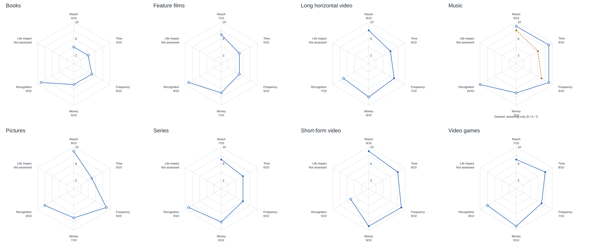
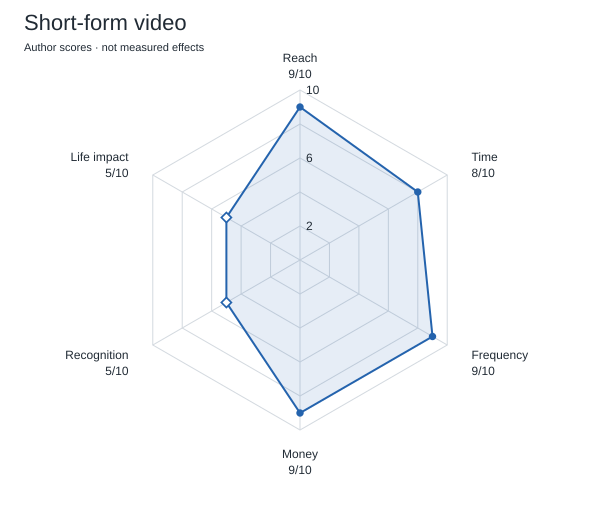
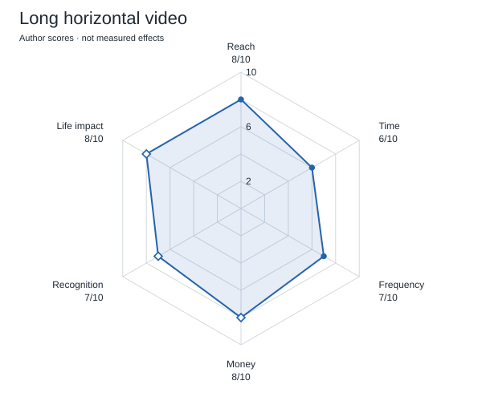
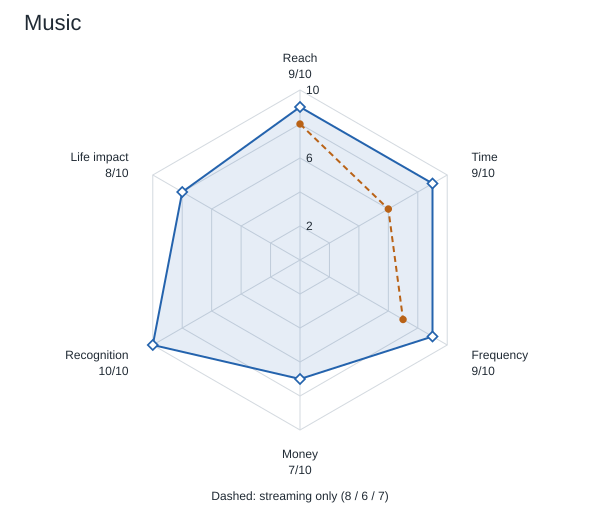
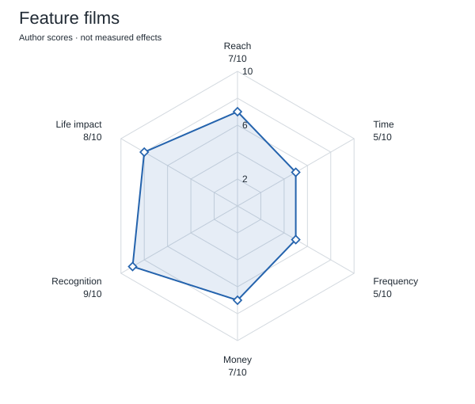
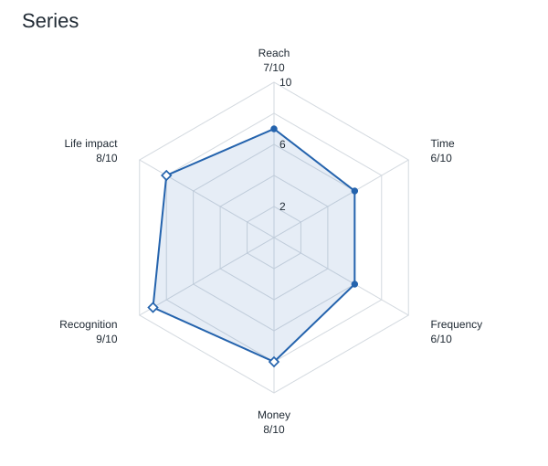
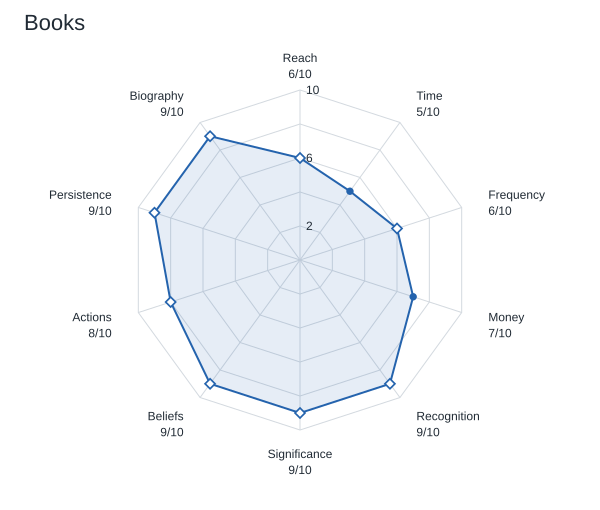
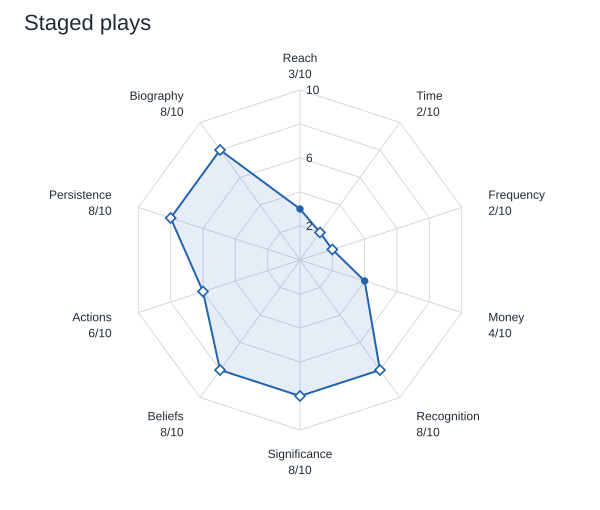
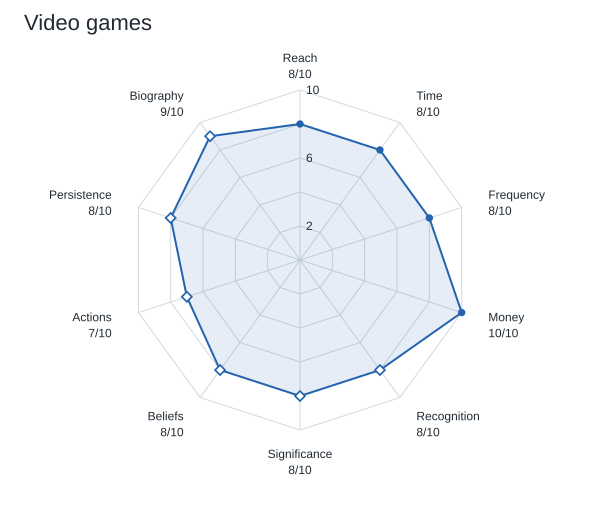

# Subjective 2026 radar profiles

All eight diagrams use the same 0–10 scale and axis order. Every score is an author judgment. Filled points have a numerical source anchor; hollow points have qualitative reasoning only. Neither kind is an objective score. Definitions and all 80 rationales are in [the data](../data/score_rationales.md).

## All eight profiles together

[Open the full-size image](../figures/radar-overview.svg) · [Short Russian annotation (TXT)](../figures/radar-overview.txt).

## Short-form video

The model emphasizes frequent, broad consumption and distinguishes an isolated clip from cumulative exposure to a feed. Its lower biographical score is a hypothesis, not a measured rate.

## Long-form horizontal online video

The model covers creator-led essays, authored vlogs, and other horizontal creative online works rather than feature films. It gives room for developed explanation, reflection, and repeated creator contact. Reach, time, and frequency are anchored to the broader GWI long-online-video proxy. Money and all impact scores are qualitative hypotheses; no long-video causal ranking is established. See the [working definition](../research/01_scope_and_metrics.md) and [new limitations](../research/04_limitations.md#additional-limitations-introduced-by-long-horizontal-video).

## Music

The model includes music beyond streaming and emphasizes repeated listening and identity. That broader scope is also why its scores should not be read as a transformation of GWI's streaming-only values.

## Feature films

The model separates episodic consumption from a work's potential for remembered characters, scenes, and perspectives.

## Series

The model emphasizes long contact with characters. Its empirical streaming and Netflix anchors also include other content.

## Books

The model gives reflection and revisiting ideas high scores. This does not establish that an average book has greater causal impact than an average game, series, or feed.

## Staged plays

The model distinguishes limited aggregate attendance from potentially intense individual experiences and the long life of a repeatedly staged text.

## Video games

The model combines broad consumption with agency and shared experience. Applying qualities of artistically ambitious games to the full casual-game market is a limitation.

## Interpretation

Differences of one point are not meaningful. Allowing roughly two points of judgment on uncertain axes could alter several apparent rankings. Do not rank polygon areas or add the axes into a single winner. The impact half describes potential for an engaged person, while the consumption half describes social scale.
